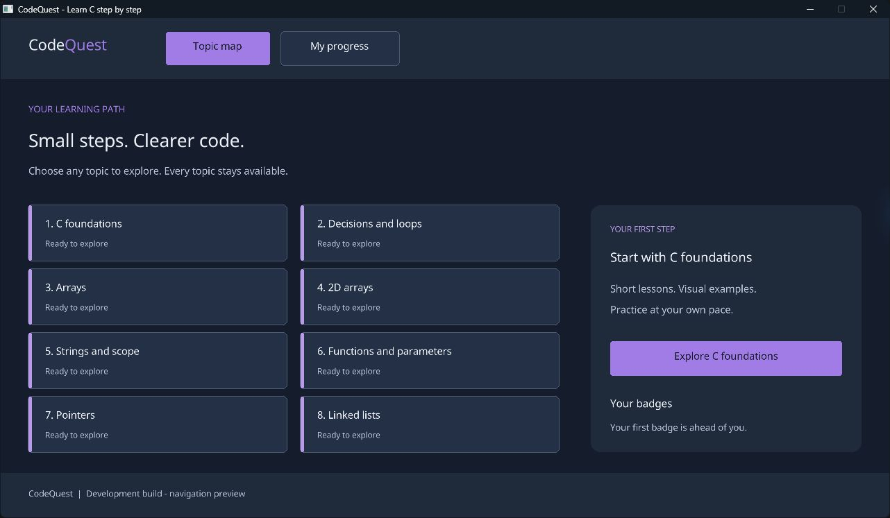

# CodeQuest

**Learn C by following the code, seeing values change and practising one concept at a time.**

CodeQuest is a Windows desktop learning app designed to help beginners understand C and selected C++ concepts. It brings short lessons, visual code walkthroughs and missing-code questions together in a colourful topic map.

Created by **Lucas Oliveira** as an Advanced Programming project, CodeQuest focuses on making programming behaviour easier to see and explain.

> **Development status:** The first C and raylib development build is working. It includes the topic map, eight topic previews and screen navigation. Lessons, questions, walkthroughs and progress saving are still in development. A standalone release is not yet available.



## The learning experience

The planned learning flow follows five steps:

1. **Explore:** choose any topic from the map or continue a previous lesson.
2. **Learn:** read a concise explanation with a labelled code example.
3. **Trace:** step through prepared examples while watching variables, arrays and pointer targets change.
4. **Practise:** select the missing code, receive feedback and retry with a hint.
5. **Track:** see completed topics and earn badges, with progress saved locally.

All topics will remain accessible. The app is designed for offline use without accounts or a server.

## Curriculum

| Topic | Concepts |
| --- | --- |
| C foundations | Types, input/output, operators and conversions |
| Decisions and loops | Conditions, iteration and problem solving |
| Arrays | Searching, insertion, deletion, reversing and rotation |
| Two-dimensional arrays | Grid traversal and changes to array values |
| Strings and scope | Null termination, word counting and variable visibility |
| Functions and parameters | Return values, C pass by value and C++ references |
| Pointers | Addresses, swaps and array/string operations |
| Linked lists | Nodes, links and insertion operations |

C and C++ examples will be labelled explicitly. Walkthroughs replay authored states; they do not compile or execute user-written code.

## Getting started

### Run the app

A Windows release has not been published yet. To run the current development build, follow the source instructions below. The development scripts supply the MSYS2 runtime path; double-clicking the executable without its runtime dependencies is not yet supported.

### Build from source

Use Windows with the MSYS2 UCRT64 toolchain and raylib installed. The current build was verified with GCC 16.2.0, CMake 4.4.4, Ninja 1.13.2 and raylib 6.0. CMake requires a compatible raylib 6.0 package. cJSON will be integrated when lesson loading is implemented.

From PowerShell in the repository root:

```powershell
.\scripts\build.ps1
.\scripts\run.ps1
```

The scripts default to `C:\msys64\ucrt64`. For a different installation, pass the same toolchain location to both scripts:

```powershell
.\scripts\build.ps1 -ToolchainRoot 'D:\msys64\ucrt64'
.\scripts\run.ps1 -ToolchainRoot 'D:\msys64\ucrt64'
```

The build produces `build/codequest.exe`. Select any topic to open its preview, use **Topic map** or **Back to topic map** to return, and select **My progress** to see the progress placeholder. Close the window or press Escape to exit.

The current window is fixed at 1280 × 720 and uses bundled Noto Sans for readable, smoothly rendered text. The build copies `assets/` beside the executable; keep that folder with the app. Lesson content and standalone distribution are planned for later milestones. The commands above were verified against an existing toolchain installation; installation on a clean machine has not yet been checked.

## Technology and architecture

| Technology | Role and status |
| --- | --- |
| C11 | Application logic and data structures |
| [raylib](https://www.raylib.com/) | Window, input, text and interface drawing |
| [cJSON](https://github.com/DaveGamble/cJSON) | Planned: lesson loading and progress serialisation |
| JSON | Editable lesson content and local progress files |
| CMake, Ninja and GCC | Windows build toolchain |

The design separates three responsibilities:

- **Interface:** screens, navigation, code panels and visual feedback.
- **Learning logic:** answer checking, walkthrough steps and completion rules.
- **Data access:** content validation, progress saving and recovery.

Keeping these responsibilities separate allows learning and storage rules to be checked independently of the window. Lesson content will live outside the C source, making it possible to add exercises without changing rendering code.

## Roadmap

- [x] Define product requirements and data design.
- [x] Approve the initial interface concept.
- [x] Set up the C and raylib application with topic navigation.
- [ ] Complete one lesson-to-practice journey.
- [ ] Add three visual walkthroughs and all eight topics.
- [ ] Implement hints, retries, saved progress and badges.
- [ ] Validate content, test recovery and package a Windows release.

Detailed tasks and progress evidence are maintained in the [development plan](DEVELOPMENT_PLAN.md).

## Quality goals

Validation will cover correct answers and explanations, accurate walkthrough states, safe step boundaries, clear hint and solution behaviour, consistent badge awards and reliable progress recovery. Interface checks will cover readable code, scrolling and mouse navigation.

The first development build compiled without warnings under `-Wall -Wextra -Wpedantic`. Manual checks verified startup, opening the Arrays preview, returning to the map, opening the progress screen and exiting cleanly with code 0. No lesson, quiz or persistence checks have been completed yet.

## Documentation

- [Development plan](DEVELOPMENT_PLAN.md)
- [Development journal](docs/DEVELOPMENT_JOURNAL.md)
- [Milestone 1 planning and design entry](docs/MILESTONE_1.md)
- [Product requirements](Documents/CodeQuest%20PRD.docx)
- [Technical architecture and data design](Documents/Technical%20Architecture%20and%20Data%20Design.docx)

